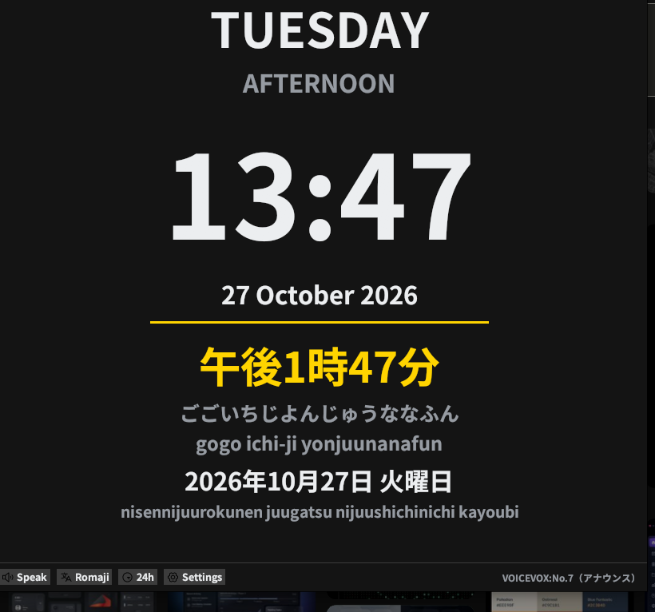
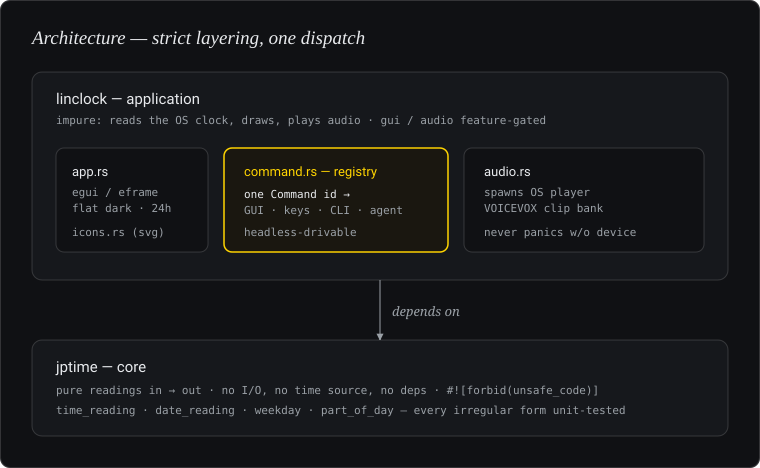

# lin-apuri-tsūru-clock

**リン・アプリ・ツール・クロック — "Lin App Tool Clock".** A native, cross-platform **Japanese learning clock**: a flat dark desk clock that shows the 24-hour time (as in Japan) with its **Japanese reading** — kanji, kana and romaji — and **speaks** the time aloud. Built in pure Rust with an immediate-mode GPU UI.

It grew out of [`clock-mod`](https://github.com/MensuraMedia/clock-mod) (reviving an old LCD "Calendar Clock"). When that device's firmware proved closed, the display and audio work moved here into a clean desktop app that runs on hardware you already own — no device, no cost.

This repository is also intended as a **reference skeleton**: a modular, universal Rust-app foundation (workspace layering, a unified command registry, dual licensing, documented engines) that other projects can fork.

<p align="center"></p>

---

## Table of contents

1. [What it does](#1-what-it-does)
2. [Technology stack](#2-technology-stack)
3. [Architecture](#3-architecture)
4. [Crates, features and functions](#4-crates-features-and-functions)
5. [The engines](#5-the-engines)
6. [Build, run and test](#6-build-run-and-test)
7. [Configuration](#7-configuration)
8. [Universal principles (reuse as a template)](#8-universal-principles-reuse-as-a-template)
9. [Project layout](#9-project-layout)
10. [Roadmap](#10-roadmap)
11. [Built with — tools, skills & MCP](#11-built-with--tools-skills--mcp)
12. [Licence & credits](#12-licence--credits)

---

## 1. What it does

- **24-hour clock face**, flat dark theme, large and legible — modelled on the original device's display (big weekday, part-of-day, large `HH:MM`, full date).
- **Japanese reading of the current time**, correct to the irregular forms a learner must know:
  `15:00 → 午後3時 → ごごさんじ → gogo san-ji`, `19:00 → 午後7時 → しちじ → shichi-ji`, `10:10 → じゅっぷん`.
- **Japanese reading of the date** incl. the weekday: `2026年10月27日 火曜日 → nisennijuurokunen juugatsu nijuushichinichi kayoubi`, with the special day-of-month readings (ついたち…とおか, じゅうよっか, はつか).
- **Speaks the time** in a natural Japanese voice (VOICEVOX) on demand or on the hour.
- **Headless/CLI mode** — the same clock as text, for scripting or a terminal.
- **Customisable**: a settings panel (⚙, or `S`) with theme presets + custom accent/text/background colours, brightness, four **text-size** presets, and a **background-image** mode (a folder shown fixed / as a slideshow / randomised, with adjustable blur and dimming). Default background is flat `#141414`.
- **Native on any desktop** (Linux, macOS, Windows) and, by design, compilable to **WebAssembly** for the browser.

---

## 2. Technology stack

| Category | Technology / details |
|---|---|
| **Language & build** | Pure **Rust**, edition **2024** (rust-version ≥ 1.92). Multi-crate **Cargo workspace** (`resolver = "3"`) with strict layering. Dual **MIT OR Apache-2.0**. |
| **UI framework** | **egui + eframe** (immediate-mode GUI). No JS/TS. Same code targets native desktop and **WebAssembly** (via `trunk`/`wasm-bindgen`). |
| **Graphics / rendering** | **wgpu** (Vulkan / Metal / DirectX 12 / WebGPU). |
| **Windowing** | `winit` via `eframe`. |
| **Time** | `chrono` (local time, calendar, weekday) — the only runtime dependency of the core beyond the UI. |
| **Audio playback** | The **OS audio player** (`paplay` / `pw-play` / `aplay` / `afplay`), spawned per clip — zero audio build dependencies. |
| **Icons** | **Phosphor** (MIT), bundled locally. Window/taskbar/Alt-Tab icon via `resvg`; toolbar via `egui_extras`' SVG loader, tinted to the theme. |
| **Audio engine (content)** | **VOICEVOX** (Japanese-native TTS) driven by the `voicepack` pipeline, producing a validated clip bank. See [docs/AUDIO.md](docs/AUDIO.md). |
| **Reading engine** | `jptime` — a dependency-free crate computing Japanese time/date readings (kanji, kana, romaji) with the irregular forms. |
| **Command architecture** | A **unified command registry**: every UI action, shortcut and CLI call dispatches by the same `Command` id — enabling headless/agent use. |
| **Packaging / platforms** | Native binary today; AppImage / Flatpak / `.deb` / `.rpm` and a WASM web build are on the roadmap. |

Nothing is installed system-wide by the app. The optional VOICEVOX engine runs locally and is only needed to *generate* the spoken clips.

---

## 3. Architecture

Strict, simple **layering** — upper layers depend on lower, never the reverse:

<p align="center"></p>

- **`jptime`** is pure logic: given numbers in, it returns readings out. No time source, no UI, no files, `#![forbid(unsafe_code)]`. This makes it trivially testable and reusable (CLI, GUI, web, another project).
- **`linclock`** owns everything impure: reading the system clock (`chrono`), drawing (`eframe`), and audio (an OS player). GUI and audio are **feature-gated** (`gui`, `audio`) so a minimal CLI build has neither.
- **The command registry** (`command.rs`) is the single dispatch point: the GUI buttons, keyboard shortcuts and the CLI all resolve to a `Command` with a stable string id, so the app can be driven without a human (agent, script, or a future JSON/MCP channel).

---

## 4. Crates, features and functions

### `jptime` (core library)

| Function | Returns |
|---|---|
| `time_reading(h24, minute) -> Reading` | `午後3時15分` / `ごごさんじじゅうごふん` / `gogo san-ji juugofun`; `:30` as 半 |
| `date_reading(y, m, d) -> Reading` | `2026年10月27日 火曜日` + kana + romaji |
| `weekday_en(y, m, d)` / `weekday_sun0(y, m, d)` | English weekday / 0=Sunday index |
| `part_of_day(h24)` | `Morning` / `Afternoon` / `Evening` / `Night` |

`Reading { kanji, kana, romaji }`. All irregular readings covered and unit-tested.

### `linclock` (application)

| Feature | Default | Enables |
|---|---|---|
| `gui` | on | the egui/eframe/wgpu desktop window |
| `audio` | on | spoken time/date via the OS audio player |

| Module | Responsibility |
|---|---|
| `main.rs` | entry point; GUI when `gui`, else the CLI clock; `--once` prints one reading and exits |
| `app.rs` | `ClockApp` (`eframe::App`): flat dark theme, responsive 24-hour layout, Japanese lines, window icon |
| `command.rs` | `Command` enum + `id()`/`from_id()` — the unified registry |
| `audio.rs` | `Player`: spawns the OS audio player for the current clip; never panics without a device |

---

## 5. The engines

### Reading engine (`jptime`)
Deterministic, dependency-free. The hard, valuable part is correctness: hours `4/7/9` (よじ/しちじ/くじ), the 分 sound changes (いっぷん/ろっぷん/じゅっぷん), months `4/7/9` (しがつ/しちがつ/くがつ), the special days (ついたち…とおか, じゅうよっか, はつか, にじゅうよっか), the day-counter `7/9` (しち/く) and year euphony (`4→よ`, `9→く`). A wrong reading teaches wrong Japanese, so every case is tested.

### Audio engine (content)
Spoken clips are produced by **VOICEVOX** (speaker No.7「アナウンス」) through the `voicepack` pipeline: chime → time(ja) → date(ja), validated (decoded peak/duration), at a measured speaking rate. The app plays the pre-rendered clip matching the current time; the generator and the licence/attribution are documented in [docs/AUDIO.md](docs/AUDIO.md). VOICEVOX attribution (`VOICEVOX:No.7（アナウンス）`) is shown in the app's About.

---

## 6. Build, run and test

```bash
# core logic (fast, no GUI deps)
cargo test -p jptime

# headless clock (no GUI/audio deps) — prints the live reading
cargo run -p linclock --no-default-features

# full native app: flat dark 24-hour clock with Japanese + audio
cargo run -p linclock                       # first build compiles eframe/wgpu (minutes)

# one-shot (scriptable)
cargo run -p linclock --no-default-features -- --once
```

Requirements: a Rust toolchain (edition 2024). The GUI needs a GPU/display at runtime; audio needs an output device and the clip bank. VOICEVOX is only needed to (re)generate clips.

The clock always reads the **local OS time and timezone** (`chrono::Local`) — no network, no fixed time.

### Desktop install (program menu · panel · Alt-Tab)

User-level, no root — builds the release binary and installs a launcher + icon:

```bash
bash packaging/install.sh      # → menu entry, pinnable panel launcher, Alt-Tab icon
bash packaging/uninstall.sh    # remove it
bash packaging/build-packages.sh   # assemble AppImage / .deb (if the tools are present)
```

The launcher sets `StartupWMClass=lin-apuri-tsuru-clock` so the running window groups under
its icon in the taskbar and Alt-Tab; the window itself also carries the icon at runtime.

---

## 7. Configuration

| Setting | Where | Default |
|---|---|---|
| Time format | `Command::ToggleFormat` (`F` / CLI) | **24-hour** (Japanese convention) |
| Romaji helper line | `Command::ToggleRomaji` (`R`) | on |
| Theme | Settings ▸ presets (Flat Dark · Midnight · Paper · High Contrast) + custom colours | Flat Dark (`#141414`) |
| Brightness | Settings ▸ slider (uniform dimmer) | 1.0 |
| Text size | Settings ▸ Compact / Standard / Large / Huge | Standard |
| Background | Settings ▸ folder + None / Fixed / Slideshow / Random, blur, dim | None (flat) |
| Audio clip directory | `assets/audio/` | bundled bank (regenerate with `voicepack timeclock`) |

### Settings panel

Open with the **⚙ Settings** button or the `S` key. It controls the theme (four flat
presets plus live accent/text/background colour pickers), a brightness dimmer, the text-size
preset, and background images: point it at a folder, pick **Fixed** (one image, with prev/next),
**Slideshow** (cycle on an interval) or **Random**, then tune **Blur** and the **Dim overlay**
that keeps the clock legible over any image. Images decode via the `image` crate and are
Gaussian-blurred on load; the current image is cached until the path or blur changes.

---

## 8. Universal principles (reuse as a template)

This project is deliberately a **starting skeleton** for other Rust apps. The reusable decisions:

- **Workspace layering**: a pure, dependency-free *core* crate (`jptime`) under an *app* crate; the core never imports the app. Enforce by review (or `cargo xtask layers` as the tree grows).
- **Feature-gated impurity**: GUI and audio behind `gui`/`audio` features, so the logic builds and tests without heavy deps, and headless/CI builds stay light.
- **Unified command registry**: one `Command` enum with stable string ids is the single dispatch for UI, shortcuts and CLI — the hook for headless/agent/JSON/MCP control.
- **Dual MIT OR Apache-2.0** licensing, the Rust-ecosystem norm.
- **Documented engines**: any non-trivial subsystem (readings, audio) gets a `docs/*.md` explaining *why*, not just *how*, and is tested for correctness.
- **Change discipline**: an append-only `changelog.md` (ISO-8601, git-independent) plus a per-release `CHANGELOG.md`, and a `CLAUDE.md` describing build/test/run — carried over from the MensuraMedia universal instruction set.

Fork this repo, rename the crates, keep the structure.

---

## 9. Project layout

```
lin-apuri-tsūru-clock/
├── Cargo.toml                 workspace (edition 2024, dual licence)
├── README.md                  this file
├── CLAUDE.md                  build/test/run + conventions
├── changelog.md               append-only change log (ISO-8601)
├── LICENSE-MIT, LICENSE-APACHE
├── CLAUDE.md · HANDOFF.md      conventions · engineer/agent handoff
├── rust-toolchain.toml         pinned toolchain
├── .github/workflows/ci.yml    fmt · clippy · test · build
├── crates/
│   ├── jptime/                 pure reading engine (lib + tests)
│   └── app/  (linclock)        egui/eframe app + CLI
│       ├── src/ main.rs · app.rs · command.rs · audio.rs · icons.rs
│       └── assets/icons/        bundled Phosphor icons (+ ATTRIBUTION)
├── assets/
│   ├── audio/                  spoken time/date clips (VOICEVOX)
│   └── screenshots/clock.png   the app
├── packaging/                  .desktop · app-icon.svg · install/uninstall · build-packages
└── docs/
    ├── ARCHITECTURE.md
    ├── AUDIO.md
    └── architecture.svg        the diagram
```

---

## 10. Roadmap

- Web build (`trunk` + WASM) from the same code.
- A resident **systray** icon (today the panel presence is the `.desktop` launcher).
- Packaging: AppImage / Flatpak / `.deb` / `.rpm`.
- On-the-hour spoken announcement and quiet hours.
- Pitch-accent display (VOICEVOX exposes per-mora accent) as a learning overlay.
- `cargo xtask layers` to enforce the layering in CI.

---

## 11. Built with — tools, skills & MCP

Developed with **Claude Code**. The practices and assets a reviewer can verify in-tree:

| Concern | How |
|---|---|
| **Diagramming** | `docs/architecture.svg` follows the *diagram-design* skill: one accent colour, 1px hairlines, a 4px grid, WCAG-AA contrast, system fonts (offline), and `role="img"` + title/description for screen readers. |
| **Iconography** | **Phosphor** icon set (local asset, MIT) bundled under `crates/app/assets/icons/` with `ATTRIBUTION.md`; rendered with `resvg` (window icon) and `egui_extras` (toolbar). |
| **Voice** | **VOICEVOX** (speaker No.7「アナウンス」) via the `voicepack` pipeline — a local engine on `:50021`, attribution shown in-app. |
| **Quality gates** | `rustfmt` + `clippy -D warnings` + tests, enforced in CI (`.github/workflows/ci.yml`); toolchain pinned via `rust-toolchain.toml`. |
| **Agent / MCP seam** | The unified `Command` registry (stable string ids, `--list-commands` / `--cmd`) is the headless control surface — the hook for a future JSON/**MCP** channel. No MCP server is required to build or run the app. |

---

## 12. Licence & credits

Dual-licensed under **MIT OR Apache-2.0** — your choice. See `LICENSE-MIT` and `LICENSE-APACHE`.

- Japanese voice: **VOICEVOX** (speaker No.7「アナウンス」) — attribution `VOICEVOX:No.7（アナウンス）` required and shown in-app.
- Reading engine and audio pipeline originate in [MensuraMedia/clock-mod](https://github.com/MensuraMedia/clock-mod); the voice-pipeline design derives from [MensuraMedia/language-learning-flashcards](https://github.com/MensuraMedia/language-learning-flashcards).

© 2026 Mensura Media.
